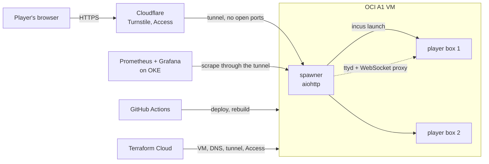

# handover-hosting

The hosting for **[The Handover](https://play.barrypekerman.com)**, a Linux &
DevOps wargame you play in the browser. Dave won the lottery and left you his
server; nothing is documented. Press play and you get your own Linux box: no
install, no signup, nobody else on it.

This repo runs it on one Oracle Cloud Always Free ARM instance. The game itself
(21 levels built by Ansible into an Incus image, with an automated solver and
leak scan in CI) lives in a separate, private repo, so the solutions stay off
GitHub.



**Design choices**

- **A container per player, with no network device.** The levels use SUID,
  sudo, processes and cron, so a shared box would let players break each other's
  games. The terminal rides `incus exec` over the control socket; a box has only
  `lo` and reaches neither other players, the host nor the internet.
- **No inbound ports.** Cloudflare Tunnel carries the game; SSH for CI and admin
  goes through Cloudflare Access. The VM's security list allows only ping.
- **One-click rebuild.** `rebuild.yml` recreates the VM, DNS, tunnel and secrets
  from Terraform, then deploys; rehearsed from nothing in about 10 minutes.
- **Approval is a manual dispatch.** Pushes only run checks; deploys run when
  someone starts them. The game image is built and tested once, then promoted.
- **Monitoring from outside.** Prometheus in a separate OKE cluster
  ([oci-oke-infra](https://github.com/BarryPekerman/oci-oke-infra)) scrapes the
  spawner and node-exporter through Access-protected tunnel routes.
- **Free tier throughout:** OCI Always Free, Cloudflare free, Terraform Cloud
  free, GitHub Actions.

## Host prerequisites (OCI A1, Ubuntu 24.04 ARM)

`host/site.yml` (Ansible) describes all of this; `deploy.yml` applies it on every
deploy, so the live box and a fresh one are configured by the same code. Dry
run: `ansible-playbook -i <host>, -u ubuntu --private-key <key> host/site.yml --check --diff`.

- Incus (`incus admin init --minimal`), `ubuntu` in `incus-admin`.
- `ttyd` (>=1.7, past the old CVE), `python3-aiohttp`, `fail2ban`, rpcbind masked,
  `fs.inotify.max_user_instances=8192`.
- A `games` btrfs pool (per-container disk quota; CoW-shares the base image):
  `incus storage create games btrfs size=30GiB`
- The `isolated` profile: no NIC, per-player caps, guest API off.
  ```
  incus profile create isolated
  incus profile device add isolated root disk pool=games path=/ size=1536MiB   # base image + ~560 MiB
  incus profile device add isolated eth0 none
  incus profile set isolated limits.cpu.allowance=50% limits.memory=512MiB limits.processes=300
  incus profile set isolated security.guestapi=false security.idmap.isolated=true
  ```
- The game image as alias `handover`. It is **not built here**: `bandit-wannabe`'s
  CI builds and tests it, and its `deploy-image` workflow imports it and moves
  the alias (the previous image stays as `handover-prev`).

## Spawner

`spawner/` (aiohttp): `spawner.py` runs the boxes, the routes and the terminal
proxy; `auth.py` is sign-in, cookies and the bot check; `metrics.py` the
Prometheus metrics and Grafana's player data; `common.py` the settings, shared
state and database; `gamedata.py` the gameplay numbers. The web pages are plain
files in `spawner/pages/` (edit the text there). A visitor's box is a container
`p-<sid>` launched from `handover` on the `isolated` profile, plus a ttyd on a
loopback port; the spawner reverse-proxies HTTP **and the terminal WebSocket**
under `/t/<sid>/`.

- **Whose box:** the `hid` cookie, or for a signed-in player their GitHub
  account, so every device signed in to that account gets the same box. Every
  connection joins the box's one tmux session, so the devices share one screen
  (images without tmux fall back to a plain shell per connection).
- **Saves and resume:** the spawner reads each reached level's password from the
  container; the page keeps them in localStorage. "Resume at level N" starts a
  new box at the highest saved level whose password matches. Resumed runs are
  kept off the leaderboard.
- **Image updates:** after an image deploy, idle boxes on the old image are
  recycled after `OUTDATED_IDLE_MIN`; an active player moves over on their
  next reload or Play, at the level they reached.
- **Leaderboard:** progress comes from each container's own login records;
  GitHub sign-in (optional) keys it across sessions.
- **Abuse:** POST-only spawning, Turnstile, a per-IP throttle, a seat cap.
- **Restarts are non-destructive:** live containers are re-adopted.

Routes: `/` landing · `POST /play` find-or-create · `/ready` · `/app/<sid>`
terminal page · `/t/<sid>/*` ttyd proxy · `/save/<sid>` · `/leaderboard` · `/story` ·
`/login` `/auth/callback` `/logout` · `/healthz`.

Config is env (see `handover-spawner.service` and the docstring at the top of
`spawner.py`); secrets come from `/home/ubuntu/handover-spawner.env`, written by CD.

### Deploying

Manual on purpose (starting it is the approval):
`gh workflow run deploy.yml -R BarryPekerman/handover-hosting` applies the host
playbook (including the tunnel connector, with its run token), copies the
spawner, writes the secrets and restarts
the service.
Pushes only run `ci.yml`. Infra: `infra/README.md`.

## Isolation

Containers run with **no network device** (`isolated` profile): the terminal
rides `incus exec` over the control socket, so a player reaches neither other
players, the host, nor the internet. Isolation is by absence, not by firewall
rule. Verified: a player container has only `lo`.

## Devices

It's a terminal game, so it's played with a keyboard: best on a computer. On a
phone you can read the story and look around; sign in with GitHub and the same
box opens on every device, so you can pick it up on a laptop.

Day-to-day operation: `docs/ops-notes.md`.

Design rationale: `HOSTING.md` in the (private) game repo.
